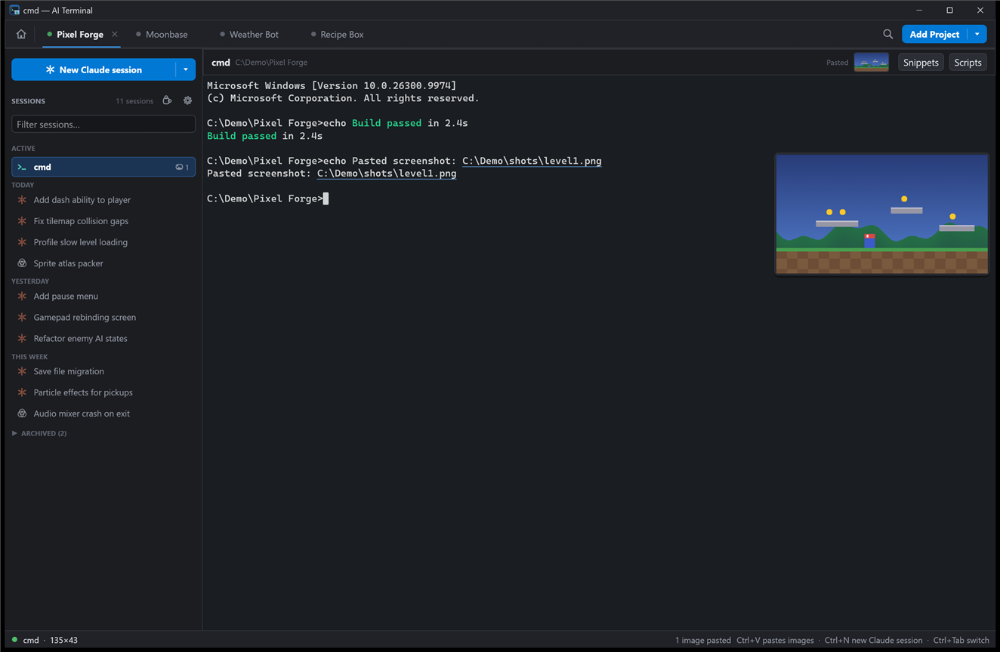
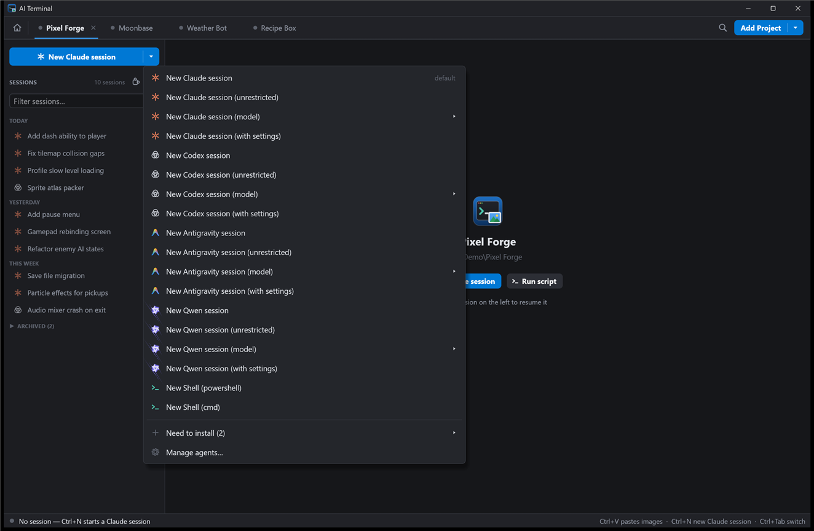
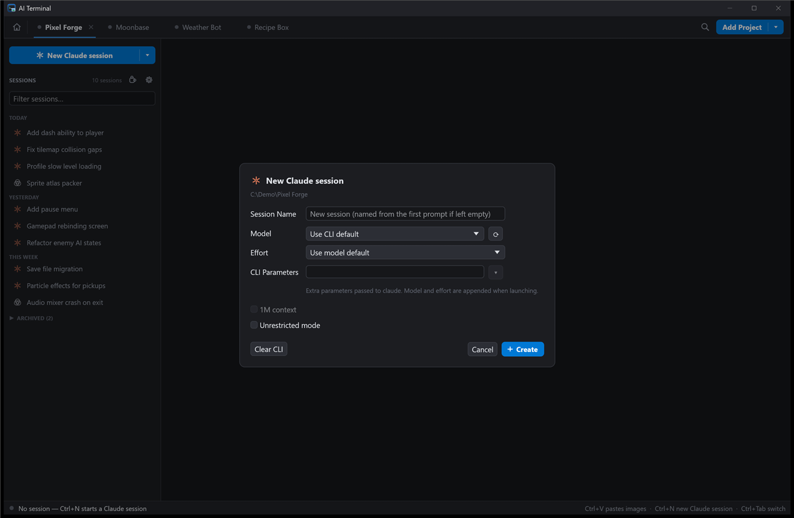
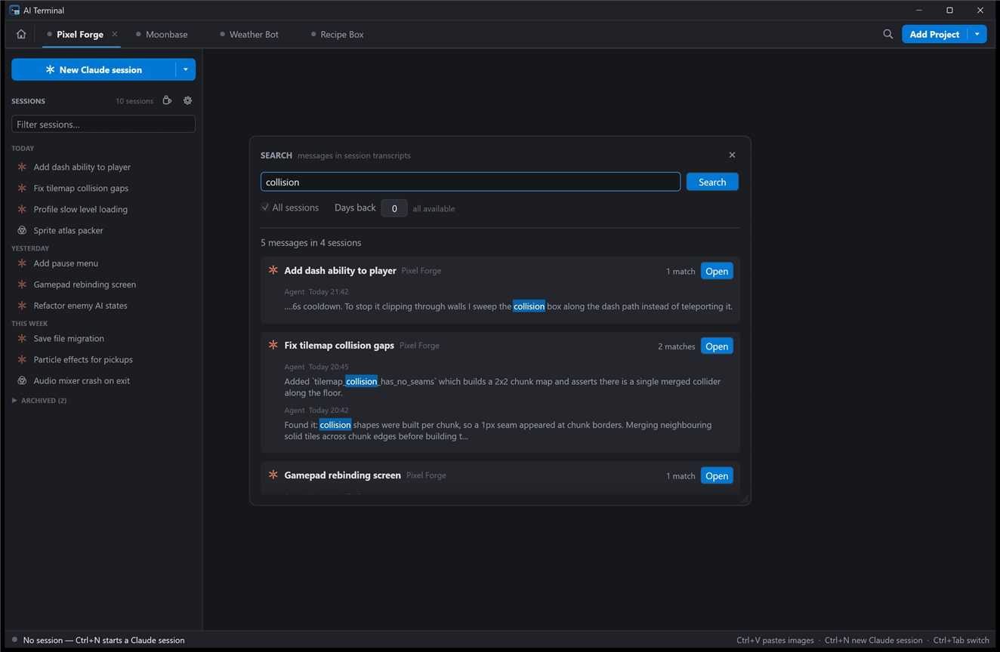
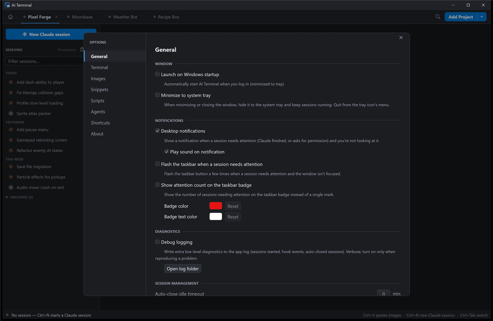
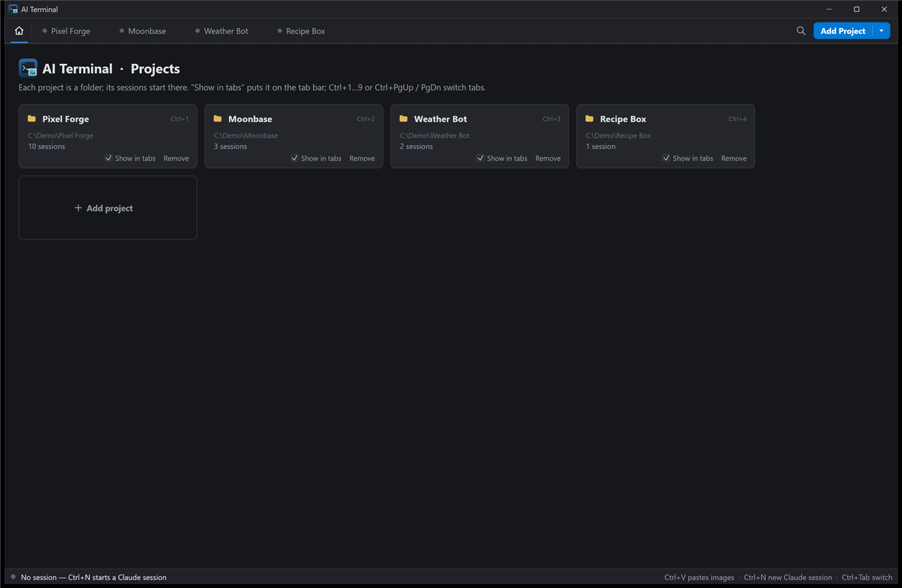

# AI Terminal

A Windows terminal for AI CLI sessions (Claude Code, Codex, Antigravity CLI, Qwen Code, OpenCode,
Kimi CLI, shells), with **previews of pasted
images inside the terminal**.



| Claude, Codex and other agents, each with model and settings variants | New session with settings |
|---|---|
|  |  |
| **Search across session transcripts** | **Options** |
|  |  |



## Download

**[Download ai_terminal.zip](https://github.com/zeroskew/AI_Terminal/releases/latest/download/ai_terminal.zip)**
(latest release). Unzip and run `ai_terminal.exe`; there is no installer. All releases are on the
[Releases page](https://github.com/zeroskew/AI_Terminal/releases). AI Terminal updates itself: it
checks for a new release now and then, downloads it in the background and, when you restart,
installs it over the exe you started (Options > General > Updates).

## Features

- **Layout**: project tabs across the top (Home + a tab per project ticked **Show in tabs**;
  a dot shows sessions, orange when one has new output), "Add Project" on the right.
  The left panel shows the selected project: the **New Claude session ▼** split button, the
  SESSIONS list (Today / Yesterday / This week…), a filter box and the Options gear. Home shows
  a card for every project, with **Show in tabs** and **Remove**. Closing a tab (its ×,
  middle-click, or right-click > Close tab) only unticks Show in tabs: the project stays on Home
  and its sessions keep running; opening it from Home brings the tab back. **Remove** (asks
  first) drops the project from the app only; the folder and its files are never deleted.
  Right-click a project tab to rename it.
- **Sessions** (terminal only). Nothing starts when the app opens. The ▼ menu has:
  - **New Claude session** (`claude --permission-mode auto`), **(unrestricted)**
    (`--dangerously-skip-permissions`) and **(with settings)**: name, model and effort (lists
    read from `claude --help`), CLI parameters with history, 1M context, unrestricted;
  - the same three for **Codex** when it's installed (`--dangerously-bypass-approvals-and-sandbox`,
    `--model`, `-c model_reasoning_effort=…`, models from `codex debug models`);
    Codex is found on PATH, in its own install folder, or inside the Codex desktop app (Microsoft
    Store), which ships the CLI;
  - **Antigravity**, **Qwen**, **OpenCode** and **Kimi** when their CLIs (`agy`, `qwen`, `opencode`,
    `kimi`) are installed: new session, unrestricted (`--dangerously-skip-permissions` for
    Antigravity, `--yolo` for Qwen and Kimi; not OpenCode) and with settings (a
    typed `--model`; OpenCode takes `provider/model`, e.g. `deepseek/deepseek-chat`). These run as
    plain terminal sessions: no resume, transcript names or cost, and they aren't kept after a restart;
  - **New Shell (pwsh / powershell / cmd)**.

  Each Claude / Codex session is linked to its conversation (the transcript in
  `~/.claude/projects` or `~/.codex/sessions`) and named from it (Claude's title, else the first
  prompt). New Claude sessions are also asked to give themselves a short name after their first
  task (Options > General > Sessions; nothing to set up per project). Sessions stay in the list after a restart and **resume on click**
  (`claude --resume <id>`, `codex resume <id>`) with the same settings; shells aren't kept.
  Right-click a session: Rename, Resume / Restart, Restart as Unrestricted / Restricted,
  Restart with settings…, Close. Double-click renames.
- **Coloured text in Claude's replies**: Claude Code's markdown has no text colour, so AI
  Terminal renders colour tags — `{green}Passed{/}`, `{red}Failed{/red}`, `{#ff8800}…{/}`
  (red, green, yellow, blue, magenta, cyan, white, gray, black, orange, purple, pink, #rrggbb).
  Backgrounds: `{bg:red}WARNING{/}` behind text, `{row:green}+ added line{/}` across the whole
  row (diff-style); named colours use Claude Code's dark diff shades (rows `#3d0100` / `#022800`,
  changed characters `#5c0200` / `#044700`), `#rrggbb` is exact.
  Tags nest: `{bg:red}{white}x{/}{/}`.
  Sessions started here tell Claude about them with `--append-system-prompt` (your CLAUDE.md
  isn't touched). A tag only counts when it opens and closes on the same line, so code like
  `f"{red}"` is left alone; the hidden tag characters become padding before the next table
  border, so tables stay aligned. Colour emoji (🟢 ✅ ⭐) are drawn in colour too. Both can be
  switched off in Options > Terminal.
- **Options** (gear): Terminal (font family and size, colour-scheme presets, background /
  foreground / cursor / selection and the 16 ANSI colours with pickers and hex values, a
  background image with opacity), Images, General, About.
- **Real terminal**: ConPTY + the alacritty VT emulator (true colour, 256 colours, alternate
  screen, mouse reporting, bracketed paste, 20 000 lines of scrollback). Box-drawing characters
  are drawn as shapes so Claude Code's frames join seamlessly.
- **Image paste**: Ctrl+V with
  - files copied in Explorer → their quoted paths,
  - a bitmap (Snipping Tool, browser "Copy image"…) → saved to
    `%TEMP%\AI_Terminal\paste\paste-<hash>.png` and its quoted path is typed, so Claude Code
    attaches it,
  - otherwise text (bracketed paste when multi-line).
  Dropping files on the window types their paths.
- **Image previews**:
  - every image path on screen (quoted or not, also when soft-wrapped, e.g.
    `"C:\...\AI_Terminal\paste\paste-2FDCD05C8532139A.png"`) and every `[Image #N]`
    placeholder Claude Code shows for a pasted image gets a **thumbnail at the right edge of the
    terminal**, next to the line; it shrinks to the free space beside the text, and several
    stack downwards,
  - hovering the path / placeholder / thumbnail shows a large preview with size and resolution,
  - clicking opens the **viewer** (fit / actual size, ← → through the session's pastes, Open,
    Show in folder, Copy image, Copy path),
  - the session header shows a strip of everything pasted into that session.
  `[Image #N]` maps to the Nth image pasted into the session (numbering restarts after
  `/clear`). View menu: previews on/off (Ctrl+Shift+I), preview height, the strip.

## Shortcuts

| Key | Action |
|---|---|
| Ctrl+V, Shift+Insert, right-click (no selection) | Paste (files / image / text) |
| Ctrl+C | Copy the selection, else send Ctrl+C |
| Right-click with a selection | Copy |
| Shift+Enter | Newline in Claude Code (sends ESC CR; Settings) |
| Ctrl+N / Ctrl+Shift+N | New Claude session / unrestricted |
| Ctrl+Shift+T / Ctrl+Shift+W | New default session / close session |
| Ctrl+Tab / Ctrl+Shift+Tab | Next / previous session of the project |
| Ctrl+PgUp / Ctrl+PgDn, Ctrl+1…9 | Previous / next project tab, project tab n |
| Ctrl+= / Ctrl+- / Ctrl+0, Ctrl+wheel | Terminal font size |
| Shift+PgUp / PgDn / Home / End, wheel | Scrollback |
| Ctrl+Shift+I | Inline image previews on / off |
| Ctrl+Alt+F | Search session messages (current session or all sessions) |
| Double / triple click | Select word / line |

Pasted images are trimmed from the paste folder at start-up and after each pasted image: files older than **Settings → Images → Keep images for** (default 30 days) are deleted, then the oldest files until the folder fits **Folder size limit** (default 1 GB). 0 means unlimited for either.

## Building

```
build.cmd build --release      (cargo inside the VS 2022 developer environment; every
                               successful --release build is copied into dist\)
build.cmd test                 (reference detection, image saving, title tests)
dist.cmd                       (same as build.cmd build --release)
build.cmd run --example mkicon (regenerates the icon: tools\mkicon.rs → assets\)
```

Rust + egui/eframe 0.37, alacritty_terminal 0.26, arboard, image. The theme, fonts and widgets
follow ASM Test Bench. The exe links the C runtime statically.

Test hooks: `ai_terminal.exe --add-project <dir> --start <Claude|Codex|cmd> --options --launch-dialog --paste-image <file> --type "<line>"` registers a file as pasted
into the first session and types a line into it (used to check previews without a keyboard).
`tools\capture.ps1 out.png` screenshots the running app without sending input.

## Tools for agent sessions (MCP)

Every Claude / Codex session started here gets AI Terminal's own MCP server (`ai-terminal`, local
HTTP with a per-launch token; Claude via `--mcp-config`, Codex via `-c mcp_servers.ai-terminal.*`),
so the agent can work with the app itself:

| Tool | What it does |
|---|---|
| `list_projects` / `list_sessions` | Projects (name, path, active, in tabs, session count) / sessions (id, terminal key, name, state, project) |
| `get_selection` | The active project tab and its selected session |
| `whoami` | The calling session's own row |
| `rename_session` | Rename the calling session ("can you rename this session?") |
| `open_project` / `open_session` | Switch tab / select (or resume) a session |
| `messaging_send` | Send a prompt to another session (waits until it's free, or `after` another session's turn) |
| `messaging_notify_when_done` | Get a prompt in your session when another session finishes its turn |
| `messaging_pending` / `messaging_cancel` | List / cancel waiting messages |
| `handoff_create_session` | Start a new session of the same kind with handoff notes as its first prompt |

### Switching MCP servers per project (status bar → MCP servers)

Every enabled MCP server sends its tool list with each request, so unused ones cost tokens
(`/context` in a session shows how many). The dialog lists, with a description of each:

| Server | What it is | How the dialog turns it off |
|---|---|---|
| `claude-artifacts` | Built into Claude Code (native install, 2.1.3xx). Publishes web pages (reports, dashboards, decks, designs) to claude.ai as private, shareable artifacts. Not needed for coding; about 8k tokens per request plus 13k deferred. Not listed by `claude mcp list`. | Deny rule `"permissions": { "deny": ["Artifact"] }` in `<project>\.claude\settings.local.json`. Everywhere: env `CLAUDE_CODE_ARTIFACT=0`. |
| `claude.ai …` (e.g. Claude Docs, Google Drive) | Connectors from your claude.ai account (claude.ai → Settings → Connectors). Claude Docs = shared docs on claude.ai; Google Drive = your Drive files (needs a Google sign-in). | `projects["<path>"].disabledMcpServers` in `~/.claude.json`, the list Claude Code's `/mcp` edits. All connectors everywhere: env `ENABLE_CLAUDEAI_MCP_SERVERS=false`. |
| `plugin:…` | Comes with an installed plugin. | Same `disabledMcpServers` list. |
| anything else | Added with `claude mcp add` or the project's `.mcp.json`. | Same `disabledMcpServers` list. |

`ai-terminal` (this app's own server) isn't listed. Changes apply to sessions started or restarted
after saving.

## Working in the terminal

- **Find** (Ctrl+Shift+F): searches the whole scrollback (case-insensitive, Aa for exact case),
  highlights matches, "n of m", Enter / Shift+Enter or ↑ ↓ to step, Esc to close.
- **Search sessions** (Ctrl+Alt+F, or the magnifier in the top bar): searches the messages (yours
  and the agent's, not tool output) in Claude / Codex / Antigravity conversations. **All sessions**
  covers every listed session in every project, archived ones included; off, only the current
  session. **Days back** limits it to recent messages (0 = everything there is). Results are
  grouped by session, newest first; **Open** (or clicking a match) switches to the session,
  resuming it if it isn't running, and opens its find bar with the query.
- **Links**: hold Ctrl over a URL or a file path (`src\app.rs:123:7`, absolute or relative to the
  session folder) and click: URLs open in the browser, files in your editor (Options > General >
  Links: VS Code, Rider, default app or a custom command with {file} {line} {col}).
- **Live status**: a spinning ring and "working…" while Claude works, "needs you" / "permission"
  when it waits (from the hooks), also as a pill in the session header.
- **Snippets** (Options > Snippets, Ctrl+Shift+S or the header button): saved prompts inserted as a
  paste, optionally followed by Enter.
- **Scripts** (Ctrl+Shift+R or the header button): `.ps1`, `.cmd`, `.bat` and `.py` files in the
  `scripts` folder next to `ai_terminal.exe`, run in the background in the current project (no
  session): a small panel at the bottom right shows the output, takes typed answers when the
  script asks something, and has Stop / Run again; a toast says when it's done. The palette shows each script's first comment
  line. The folder is created on first use with a sample, "Commit and push": one small Claude Haiku
  call (`claude -p`, no tools, short system prompt, ~1.5k tokens) writes the message from the
  diff, then it asks before committing and pushing. Options > Scripts (or "Edit scripts…" in the
  palette) edits them in place: rename, Save, Revert, Delete, open in your editor, add new ones.
  Or ask an agent to write one: **Copy prompt** there copies a starter request with the folder and
  conventions filled in; paste it into a session and say what the script should do.
- **Cost**: estimated cost and tokens per session from the transcript (Claude: per message,
  subagents included; Codex: token totals), in the header (breakdown on hover) and the
  project tab tooltip. Prices: `assets\pricing.json`, overridable with
  `%APPDATA%\AI Terminal\pricing.json`.
- **Model**: the header shows the model of the latest reply next to the agent ("Claude · Opus 5.5"),
  so it stays visible after the startup banner has scrolled away and follows `/model` switches.
- **Order**: drag project tabs to reorder them; right-click a session > Pin to top, and drag pinned
  sessions to order them.
- **Archive**: each project lists its 20 most recently used sessions (Options > General > Sessions
  > "Keep the last N sessions", 0 = all); older ones move to the collapsed **Archived** group at
  the bottom of the list. Running and pinned sessions are never archived. Right-click a session >
  Archive / Restore to list; click an archived one to resume it. The filter also searches the
  archive.
- **Idle**: the app doesn't redraw while nothing changes (0 CPU when idle).
